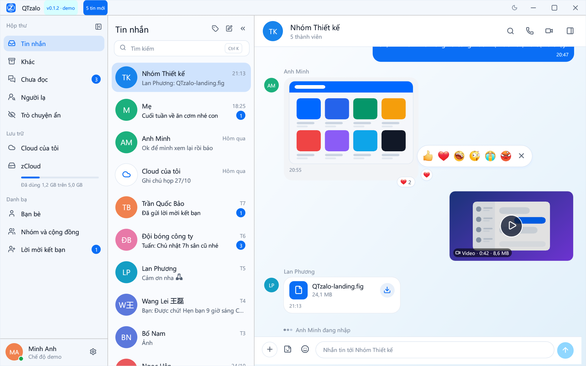

## QTzalo v{{VERSION}}

Ứng dụng Zalo desktop native viết bằng Rust, không chính thức. Bản build từ commit `{{COMMIT}}`.

### Tải về

| Hệ điều hành | File |
|---|---|
| **Windows 10/11 x64 (bộ cài)** | `QTzalo-{{VERSION}}-setup-windows-x86_64.exe` |
| Windows 10/11 x64 (portable) | `QTzalo-{{VERSION}}-portable-windows-x86_64.exe` |
| Ubuntu 22.04+ / Debian 12+ | `qtzalo_{{VERSION}}_amd64.deb` |
| Linux khác (glibc ≥ 2.35) | `qtzalo-{{VERSION}}-linux-x86_64.tar.gz` |
| macOS Apple Silicon (thử nghiệm, nếu có) | `QTzalo-{{VERSION}}-macos-arm64.dmg` |

Kiểm tra file bằng `SHA256SUMS.txt`. Bộ cài Windows chưa ký số: nếu SmartScreen cảnh báo, bấm **More info → Run anyway** sau khi đã kiểm tra SHA256. Hướng dẫn chi tiết: [docs/CAI_DAT.md](https://github.com/quangthoai1985/QTzalo/blob/v{{VERSION}}/docs/CAI_DAT.md).

### Điểm mới

- **Thả cảm xúc khi rê chuột:**
  - rê chuột vào tin nhắn thì hiện nút tròn cạnh bong bóng, bấm là thả 👍;
  - dừng chuột trên nút để chọn 1 trong 6 cảm xúc; nút ✕ gỡ hết cảm xúc của bạn trên tin.
- **Đếm cảm xúc giống Zalo:** mỗi lần bấm cộng thêm một, các cảm xúc khác nhau cộng dồn; rê lên chip để xem chi tiết.
- **Cảm xúc theo thời gian thực:**
  - cảm xúc của người khác, và của chính bạn thả từ điện thoại, hiện ngay;
  - cảm xúc thả lúc QTzalo đang tắt được bù khi mở app.
- **Sửa lỗi:**
  - cảm xúc trên tin của chính bạn, gồm mọi tin trong "Cloud của tôi", nay khớp với điện thoại cả hai chiều;
  - thả cảm xúc không còn xoá cảm xúc của người khác;
  - kênh dự phòng cho sự kiện cuộc gọi (`lp_control`) không còn bị máy chủ từ chối liên tục với lỗi 413.

Xem đầy đủ: [CHANGELOG.md](https://github.com/quangthoai1985/QTzalo/blob/v{{VERSION}}/CHANGELOG.md).

### Lưu ý

- Dữ liệu người dùng nằm ở `%APPDATA%\QTzalo` (Windows) / `~/.local/share/qtzalo` (Linux). Lần đầu chạy, dữ liệu cũ trong thư mục làm việc được tự động chuyển vào đây.
- Trên một máy vừa đăng nhập lần đầu, máy chủ Zalo chỉ gửi tin từ sau lần đăng nhập đó; lịch sử cũ (nhất là của nhóm) chưa lấy được. Tính năng "đồng bộ từ điện thoại" đang được nghiên cứu.
- Cảm xúc được lưu theo dạng mới. Nếu quay lại bản 0.1.2, cache hội thoại sẽ bị bỏ qua; lịch sử trong SQLite vẫn còn.
- Với tin **cũ** do bạn gửi trong hội thoại 1-1 trước bản này, cảm xúc thả từ điện thoại có thể chưa hiện trong QTzalo (thiếu `cliMsgId`). Tin mới không bị ảnh hưởng.
- QTzalo không liên kết với VNG / Zalo. Dùng client bên thứ ba có thể vi phạm điều khoản dịch vụ của Zalo.
